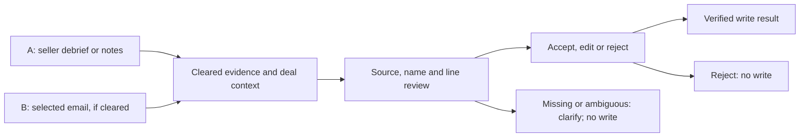
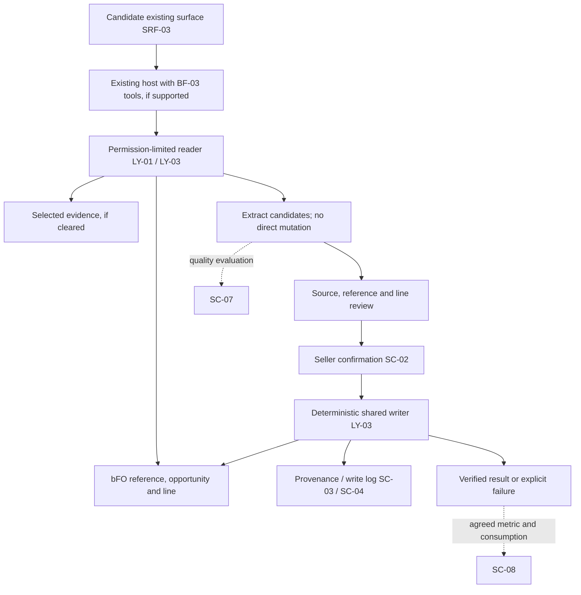

::: {.readme}
**In 30 seconds.** Provisional draft for Samer, CRM Assistant requester, and the future PO, UX and architecture owners. It proposes competitor capture as part of the post-meeting experience, with seller-confirmed writes to the intended bFO opportunity line. The early-stage recommendation path is a separate investigation. This is not an approved design: the [guide v0.3](02-workshop-guide.md) is Prefilled, not validated; no workshop validation, Roadmap verdict, architecture inputs or family AI-fit statement were supplied. Decisions are Proposed or Open in 3.1; 3.2 and 3.3 apply them by ID. The requester approved publication of this transcript-derived guide and dossier to the public repository; the source transcript itself is not included. (intake; intro call, 30 Sep, 12:07–14:06, 36:17–36:56, 41:32–43:02, 51:02–52:29; requester approval, 14 Oct)
:::

# At a glance

Help the Seller record competitors mentioned in a debrief, meeting note or selected email on the right opportunity line, without retyping. EMEA field sellers are the first population proposed, not an agreed pilot. Start with a prompt comparison, then a capture capability on an existing conversational surface using a shared confirmed writer, subject to feasibility and source permissions. Release 1 does not scan mailboxes autonomously, invent competitors from history, generate deal strategy or build manager dashboards. The exact surface, population, metric definition and delivery dates remain to validate. (intake; intro call, 30 Sep, 26:26–27:18, 36:17–43:02, 48:27–50:44; CMP-01, CMP-04, CMP-05, CMP-09, CMP-13, CMP-14)

## Scenario canvas

| Dimension | Decision for this scenario | IDs |
|---|---|---|
| D1 · Seller job and journey | Proposed: record customer-mentioned competitors on the right line without retyping; persona Seller; primary metric candidate is line-level competitor coverage, definition unresolved. (intake; intro call, 30 Sep, 26:26–27:18, 50:01–50:44) | CMP-01, CMP-02 · JM-05 · P1, P10, P11 |
| D2 · Usage pattern | Proposed: UP-07 for capture/validation; the wider host may use UP-09, not a second standalone competitor experience. Benefit sought: less re-entry and fewer steps. (intro call, 30 Sep, 12:07–14:06, 26:26–27:18, 41:32–43:02) | CMP-03 · UP-07 · P8, P9 |
| D3 · Surface and build form | Proposed: seller-initiated text confirmation on SRF-03, fixed Microsoft control; field-update output; BF-01 comparison then BF-03 tools on an existing host. Host/tool fit is Open; no competitor-specific BF-04 justification. (intro call, 30 Sep, 11:28–14:06, 41:32–43:02; catalogues/srf.yaml, bf.yaml) | CMP-04, CMP-05 · SRF-03 · BF-01, BF-03 · P2, P3, P4 |
| D4 · Architecture and shared layers | Proposed: selected evidence plus bFO reference/line reads, shared confirmation/provenance/writer, evaluation and monitoring. Adds scenario-specific extraction/matching tests, not a new shared intelligence signal. Component availability is not verified. (intro call, 30 Sep, 18:43–22:05, 43:06–45:43; guide E; catalogues/ly.yaml) | CMP-06, CMP-10, CMP-12 · LY-01, LY-03, LY-04, LY-05 · SC-02, SC-03, SC-04, SC-07, SC-08 · P5 |
| D5 · Guardrails and safeguards | Proposed: seller confirmation before any write; permission-limited evidence; source labels and visible uncertainty; seller-owned assessments; reversible write log. Legal clearance, retention and thresholds are Open. (intro call, 30 Sep, 36:17–38:33, 48:27–49:39; guide C, G) | CMP-07–CMP-12 · GR-01–GR-06 · SG-01–SG-04 · P6, P7 |

## Where we are

| Item | Status |
|---|---|
| Track | Standard, Proposed: source processing needs legal review and CRM write/host readiness is unverified; front-matter records the proposed track, not its validation. (guide F, G; template light-track criteria) |
| Next gate | Framing lead: when will guide validation, overlap and Roadmap decisions take place? Design review and Go build are downstream gates, not scheduled or authorised. (guide I) |
| Blockers before the review | Five groups: guide/overlap/owners and pilot (CMP-01, CMP-06, CMP-13, CMP-15); metric/baseline (CMP-02); surface/writer/schema (CMP-04, CMP-05, CMP-07, CMP-10); clearance/access/retention (CMP-09, CMP-11); evaluation and mockup (CMP-12). Checklist is still unassessed; this is not its verdict. (guide I) |
| Changes proposed to the framework | No new CH item raised. CH-01 and CH-02 remain existing Proposed items, not approvals or new tag definitions to apply. Existing IDs cover this draft. (guide I; catalogues/changes.yaml) |
| Filed with the dossier | [Guide](02-workshop-guide.md), intake and unassessed checklist are in this repository; the original call transcript is not included. No workshop transcript or rendered mockup supplied. (guide Before the workshop, I; requester approval, 14 Oct) |

# 3.1 Scenario brief

Owner: PO, to nominate. Proposed: make evidence-based competitor capture part of the seller's existing post-meeting work, not another agent to discover. The first build candidate handles selected inputs and a reviewed competitor-to-line link through a shared writer. PO: validate the guide and the dependencies before treating this scope as a commitment. (intro call, 30 Sep, 12:07–14:06, 41:32–43:02, 51:02–52:29; guide D, F)

## Ask and positioning

| Item | Content |
|---|---|
| Ask as received | "an agent that scans Outlook and puts the competitors into bFO automatically" (intake) |
| Ask as reframed | Proposed: record the competitors customers mention on the intended opportunity line, without retyping, after the seller reviews the proposal. Not workshop-validated. (intake; intro call, 30 Sep, 26:26–27:18, 36:17–36:56; CMP-01, CMP-07) |
| Positioning in the portfolio | Proposed: extend/group post-meeting capture; reuse shared CRM editing and reference data; assess the existing default action for creation-time suggestions; route material/reporting needs to their owners. Design authority: confirm the overlap verdict and accountable hosts. (intro call, 30 Sep, 11:28–14:06, 17:41–18:43, 34:39–36:07, 51:02–52:29; CMP-06, CMP-14) |
| Not promised | Autonomous mailbox processing, automated phone recording, an independent competitor agent, strategy/forecast judgement, a new reference-data creation path, or manager dashboard delivery. PO: confirm first-release exclusions and route owners for secondary needs. (intake; intro call, 30 Sep, 37:54–43:02, 43:06–45:43, 48:27–49:39; CMP-08, CMP-10, CMP-13, CMP-14) |

## Job, persona, activity · D1

| Item | Content |
|---|---|
| Job in one sentence | Record the competitors customers mention on the right opportunity line, without sellers re-typing them. (intake; CMP-01) |
| Persona | Seller; field sellers in EMEA first, with managers reading confirmed CRM data under existing rights. Samer: which seller roles/countries, how many users, and who sponsors the pilot? (intake; intro call, 30 Sep, 27:19–28:31, 38:33–40:19; CMP-01, CMP-11, CMP-15) |
| Seller activity | Proposed: JM-05; the wider meeting workflow is the host, not another primary activity for this scenario. (intro call, 30 Sep, 41:32–43:02; catalogues/jm.yaml; CMP-01) |
| Split or group | Group debrief/notes and selected-email capture around one confirmation/write path. Separate likely-competitor suggestions from captured mentions; route competitive material and analytics rather than duplicate them. (intro call, 30 Sep, 3:16–5:13, 34:39–36:07, 46:10–48:20; CMP-06, CMP-14) |

## Friction today and seller benefit · D1, D2

| Friction today | Benefit sought |
|---|---|
| Meeting/email competitor mentions are re-entered late or not at all. (intake; intro call, 30 Sep, 30:13–31:05) | Capture from the seller's supplied evidence with less retyping. (CMP-01, CMP-03) |
| Sellers see limited immediate value; closure-only mandatory entry can reduce quality. (intro call, 30 Sep, 23:27–24:17) | A reviewed competitive picture while the deal is active, rather than only at loss. (CMP-01, CMP-07) |
| Missing history limits management analysis; the default action's gap is unknown. (intro call, 30 Sep, 2:28–3:46, 17:41–18:43) | More complete confirmed data for existing consumers; investigate defaults before additional inference. (CMP-06, CMP-14) |

Samer emphasised data quality, but no ranked trade-off between coverage, speed and seller usefulness was supplied. No measured baseline exists in the supplied material. PO: agree the priority and avoid claiming quantified time or win-rate gains. (intro call, 30 Sep, 23:51–24:17, 28:31–29:45, 50:01–50:44; CMP-02)

## Usage pattern and surface · D2, D3

| Item | Decision |
|---|---|
| Usage pattern | Proposed UP-07; UP-09 belongs to the wider post-meeting host. (intro call, 30 Sep, 41:32–43:02; CMP-03) |
| Surface and level of control | Preferred comparison candidate: SRF-03, Fixed by Microsoft, on demand. SRF-05 is a Configurable alternative with preview API constraints; SRF-10 is Not decided. UX/platform owners: verify supported tools/confirmation and select the feasible surface before selecting build form. (catalogues/srf.yaml; guide F; CMP-04) |
| Format | Proposed: sourced conversational proposal, seller review and field-update result. No dedicated form or custom card dependency is assumed. (intro call, 30 Sep, 36:17–36:56, 41:32–43:02; UP-07; CMP-03, CMP-04, CMP-07) |

The functional application is in 3.2; tool availability, exact host and any fallback remain Open under CMP-04 and CMP-05. (guide F, G)

## AI fit and build form · D3

| Phase of the work | AI | Deterministic | Seller |
|---|---|---|---|
| Read supplied evidence | Extract competitor mentions from natural language. (guide F) | Enforce approved source scope and user rights; retrieve allowed records. (CMP-09) | Supplies/selects the evidence and deal context. (intro call, 30 Sep, 41:32–43:02) |
| Match and propose | Suggest candidate names and links with uncertainty, not final IDs. (guide E) | Resolve against permitted reference records and allowed line links; exact matching rules are Open. (CMP-10) | Resolves ambiguity and reviews the source/target. (CMP-07, CMP-10) |
| Review output | Draft a concise sourced proposal, not a forecast or strategy. (CMP-08) | Maintain provenance and apply the confirmation pattern. (CMP-07, CMP-11) | Accepts, edits or rejects each proposed change. (intro call, 30 Sep, 36:17–36:56) |
| Write and report | No direct model-owned mutation. (P6) | Shared writer validates, writes and logs the confirmed payload; owner must define failure/reversal handling. (CMP-07, CMP-12) | Sees the explicit success/failure result and can request correction. (SG-04; CMP-12) |

**Build form:** Proposed BF-01 comparison before BF-03 on an existing host (CMP-05). BF-02 must be checked for a sufficient standard capability, particularly SRF-05; it has not been tried or ruled out. Neither BF-05 nor a replacement host is committed without evidence of a capability gap. (guide F; catalogues/bf.yaml; P3, P4)

**Why this build form:** No separate competitor trigger or identity is established; post-meeting is the host, so this draft does not justify BF-04 under P2. (intro call, 30 Sep, 41:32–43:02, 51:24–52:29; CMP-05)
Selected-evidence prompting can test extraction; verified reference reads, authorised CRM writes and auditability need tools beyond a prompt. Architecture lead: prove those needs cannot be met by standard configuration before approving BF-03. (guide F; P4; CMP-05)

## Boundary · D5

Proposed boundaries for validation; the call explicitly supports confirmation and retained seller judgement, but this release design has not been approved. The solution never:

- Writes a proposal the seller has not accepted, or treats rejection as permission. (intro call, 30 Sep, 36:17–36:56; CMP-07)
- Changes close date/forecast or judges win probability and strategy from competitor mentions. (intro call, 30 Sep, 37:54–38:31; CMP-08)
- Converts a historical guess, loss reason or competitor-price claim into a customer-confirmed fact. (intro call, 30 Sep, 3:16–4:38, 38:33; intake; CMP-08, CMP-11, CMP-14)
- Reads beyond cleared sources/user rights, invents a missing competitor or chooses an ambiguous line silently. Architecture/legal owners: confirm these failure boundaries and the unknown-name route. (guide C, E, G; GR-02, GR-04, GR-05; CMP-09, CMP-10)

Applied references: GR-01 for each proposal write; GR-02–GR-06 for access, decision scope, uncertainty, source clearance and sensitive claims; SG-01–SG-04 for source labels, freshness, evaluation and logging. Owner-specific unresolved controls are logged below, not represented as implemented. (catalogues/gr-sg.yaml; CMP-07–CMP-12)

## Success · D1

| Level | Criterion | Baseline |
|---|---|---|
| Primary metric (P11) | Candidate: % of eligible opportunity lines with a competitor recorded. Samer/reporting owner: choose line versus opportunity denominator, cutoff/stage, target and measurement window; distinguish customer evidence from defaults. (intake; intro call, 30 Sep, 6:18–7:09, 50:01–50:44; CMP-02) | No measured figure supplied; "almost zero" is qualitative. Reporting owner: obtain the agreed extract. (intro call, 30 Sep, 22:50–24:17) |
| This cycle | PO: confirm whether guide validation, overlap verdict and scope/metric agreement are the cycle exit. (guide H, I; CMP-01, CMP-02, CMP-06) | Gate dates and owners not supplied. (guide I) |
| Release 1 | Proposed: confirmed competitors on intended lines without retyping; quality and safety acceptance thresholds must be agreed before pilot. (guide H; CMP-07, CMP-10, CMP-12, CMP-13) | No evaluated capture/matching results supplied. (guide I) |
| Next cycle | PO: decide expansion only from pilot evidence and legal/platform readiness; no promised win-rate effect. (guide H; CMP-13, CMP-14) | No next-cycle commitment supplied. (guide H) |

Secondary candidates, not additional primary metrics: lost opportunities with competitor/loss reason, re-entry effort and proposal correction rates. Reporting/evaluation owners: select only measures that test the agreed value and errors; proposal acceptance alone is not the business outcome. (intro call, 30 Sep, 26:26–27:18, 50:01–50:44; guide H, I; CMP-02, CMP-12)

## Phasing

| Release | When | Scope |
|---|---|---|
| 0 | PO: when can an authorised comparison be run? (guide I) | Proposed prompt comparison using approved anonymised evidence; no automated write and no assumed mailbox connector. Compare existing configuration/default action. (guide F; CMP-05, CMP-09, CMP-14) |
| 1 | PO: agree date after guide, host, legal and writer readiness. (guide I) | Proposed selected-evidence capture; source/name/line review; confirmed shared write and explicit outcome, subject to evaluation. EMEA pilot selection remains Open. (guide D, H; CMP-01, CMP-07, CMP-10, CMP-12, CMP-13, CMP-15) |
| 2 | PO: is expansion justified by pilot results and owner commitments? (guide H) | Early-stage suggestions and automatic detection are conditional investigations, not promised delivery. Positioning material/reporting stays with existing owners. (guide D, F; CMP-06, CMP-14) |

## Decision log

All dates below are draft registration dates, not validation dates. Samer is the domain requester, not an assigned PO, data steward or legal approver. Unnamed roles are proposed validation owners to nominate. (guide Before the workshop, I)

| ID | Decision | Status, date | Owner |
|---|---|---|---|
| CMP-01 | Capture customer-mentioned competitors on the intended opportunity line without retyping; one primary persona Seller, JM-05; EMEA first, pilot not selected. (intake; intro call, 30 Sep, 26:26–27:18) | Proposed, 14 Oct 2026 | Samer: confirm scope/users; PO to nominate. |
| CMP-02 | Which one business metric, denominator, cutoff, target, baseline and measurement period will be used? Line coverage is the intake candidate, not a settled replacement for the call's stage-two opportunity measure. (intake; intro call, 30 Sep, 6:18–7:09, 50:01–50:44; P11) | Open, 14 Oct 2026 | Samer and reporting owner to nominate. |
| CMP-03 | UP-07 is the primary pattern; apply its conversational confirmation principle inside the wider post-meeting workflow, not a separate competitor process. (intro call, 30 Sep, 41:32–43:02; UP-07, P9) | Proposed, 14 Oct 2026 | Samer and UX lead to nominate. |
| CMP-04 | Which existing surface/host supports evidence input, reference tools and text confirmation? Prefer testing SRF-03; verify SRF-05 alternative and SRF-10 readiness without assuming preview/voice capabilities. (guide F, G; catalogues/srf.yaml; P3) | Open, 14 Oct 2026 | UX/platform owners to nominate. |
| CMP-05 | Compare BF-01 and sufficient BF-02 capability before BF-03 tools; no separate competitor BF-04 identity is justified. Tool availability and selected build form require proof on CMP-04's surface. (guide F; intro call, 30 Sep, 41:32–43:02; P2, P4) | Proposed, 14 Oct 2026 | Architecture/platform owners to nominate. |
| CMP-06 | Extend/group post-meeting capture; consume shared writer/reference components; route material/reporting. Confirm ownership and overlap; do not create LY-02 signals without two committed consumers and an owner. (guide D, E; intro call, 30 Sep, 34:39–36:07, 51:02–52:29; P5) | Proposed, 14 Oct 2026 | Design authority; framing lead to nominate. |
| CMP-07 | Seller accepts/edits/rejects a sourced proposal for a specific competitor and opportunity line before a deterministic shared write. No rejected/unconfirmed payload is written. (intro call, 30 Sep, 36:17–36:56, 41:32–43:02; GR-01, SC-02) | Proposed, 14 Oct 2026 | Samer, UX and architecture leads to nominate. |
| CMP-08 | Seller retains forecast/date/probability/strategy decisions; positioning and loss reason remain declarative; history is not a customer statement. (intro call, 30 Sep, 3:16–4:38, 37:54–38:33; GR-03, P10) | Proposed, 14 Oct 2026 | Samer and PO to nominate. |
| CMP-09 | Which approved inputs, countries, identities, consent and access rules allow debrief/selected-email/meeting processing? Source selection is not legal clearance; no mailbox scanning or elevated-reader shortcut is authorised. (intro call, 30 Sep, 48:27–49:39; GR-02, GR-05) | Open, 14 Oct 2026 | Legal/privacy and access owners to nominate. |
| CMP-10 | How do competitor lookups, aliases, line links, duplicate handling, roll-up and master-data permissions work? Propose explicit unresolved-match/line handling with no guessed IDs or automatic reference creation; verify schema first. (intro call, 30 Sep, 20:46–25:05, 43:06–45:43; GR-04) | Open, 14 Oct 2026 | bFO data/process and architecture owners to nominate. |
| CMP-11 | How are sources, dates and permitted provenance tags displayed/stored, sensitive prices labelled, proposals kept seller-private and confirmed data shared under rights? Define retention per artefact; CH-02 is not an approved new tag set. (guide C, G; intro call, 30 Sep, 38:33–40:19; SG-01, SG-02, GR-06) | Open, 14 Oct 2026 | UX, legal and access owners to nominate. |
| CMP-12 | What evaluation cases/thresholds, audit/reversal process and failure messages permit release? Propose tests for extraction, matching, rights, ambiguity, confirmation and write errors; no success without a verified outcome. (guide I; SG-03, SG-04, SC-04, SC-07) | Open, 14 Oct 2026 | Evaluation, UX and architecture owners to nominate. |
| CMP-13 | Selected-evidence capture is the first build candidate, after approved prompt comparison; no autonomous mailbox, strategy or dashboard build in release 1. Standard track proposed; no release dates committed. (guide D, F, H; intro call, 30 Sep, 38:33–43:02) | Proposed, 14 Oct 2026 | Samer and PO to nominate. |
| CMP-14 | How should creation-time suggestions extend the existing default action, and what approved comparison method/stage/evidence labels would justify history? Automatic mailbox queues and content distribution remain conditional later options, not release-1 dependencies. (intro call, 30 Sep, 3:16–5:13, 17:41–18:43, 29:45–30:13, 46:10–48:20; P10) | Open, 14 Oct 2026 | Samer, bFO owner and design authority; legal for mailbox path. |
| CMP-15 | Who owns 3.1/3.2/3.3, host/writer operations and pilot; what licences, environment/stack ID, run budget, dates and certification path apply? None supplied as commitments. (guide Before the workshop, G, I) | Open, 14 Oct 2026 | Framing lead: nominate PO/UX/architecture, platform and certification owners. |

# 3.2 Functional overview

Owner: UX lead, to nominate. This section is an illustrative application of CMP-01, CMP-03, CMP-04, CMP-07 and CMP-10–CMP-13, not a validated screen design. Path A starts with seller-provided meeting/debrief evidence; B uses a selected email if authorised. Both share a review step. UX lead: validate entry, missing-context prompts and result language with sellers. (guide C–F)

## Journey at a glance · D2

Proposed journey for CMP-07, CMP-09, CMP-10 and CMP-12: paths end in a verified result, explicit blocked/error state or rejection; no guessed update. Creation-time suggestions and autonomous scans are not release-1 entries (CMP-14). UX lead: confirm these flows; the source does not establish an implemented UI. (guide C, D, F, I)

## Key moments

| Step | What the solution does | Why it matters |
|---|---|---|
| 0 · Entry | Shows selected source scope and the supplied deal context; asks only for missing critical context. (guide C, E; P9) | Makes input boundaries visible; CMP-09, CMP-10. |
| A1 · Extract | Drafts competitor mentions and exposes their supporting source; does not infer customer statements from history. (guide C, F) | Maintains the evidence distinction; CMP-08, CMP-11. |
| A2 / B1 · Resolve | Presents a reference candidate and target line; unresolved cases are shown rather than written. (guide E) | Avoids a plausible but wrong target; CMP-10. |
| A3 / B2 · Review | Presents the proposed change and seller response choices, with existing-data conflicts visible. (guide C; SC-02) | Approval applies to the reviewed proposal; CMP-07, CMP-11. |
| A4 / B3 · Result | Displays confirmed write outcome, rejection or explicit error; no success-shaped fallback. UX/architecture owners: specify partial/unknown outcomes and recovery. (guide I; SG-04) | Makes failed/uncertain writes visible; CMP-12. |

## Where it appears · D3

| Item | Content |
|---|---|
| Surface | CMP-04 governs selection; SRF-03 is the comparison candidate, SRF-05 a feasibility alternative, not a second committed UI. (guide F; catalogues/srf.yaml) |
| Level of control | Seller starts capture on demand; Microsoft controls SRF-03. UX lead: confirm entry into the existing host and selected-email hand-off. (guide F; CMP-04) |
| Format | Apply CMP-03 and CMP-07 in text; tool-supported field-update outcome is conditional on CMP-04/CMP-05. No file, custom-card or notification requirement for release 1. (guide F) |

| Capability needed | Available on the surface |
|---|---|
| Text review and authorised write tools | SRF-03 lists answer/write-back formats, but this tenant's competitor/line tool support is unverified. Platform owner: demonstrate it. (catalogues/srf.yaml; CMP-04, CMP-05) |
| Structured cards | Not required for the proposed text path; do not assume a custom-card renderer on SRF-03. UX lead: is text sufficient? (CMP-03, CMP-04; guide F) |
| Progressive step display | Not required for capture; host-process UX remains its owner's decision. UX lead: what progress state is supported? (CMP-03, CMP-04; guide F) |
| File output opened from chat | Not required for a field update. UX lead: any justified file requirement? (CMP-04; guide F) |
| Push delivery | Not selected for release 1. A future SRF-06/SC-06 path needs host/cost verification and an actionable destination, not a dead-end alert. (CMP-14; guide F; P8) |

## UI principle of the usage pattern · D2

- UP-07: "One change confirmed in one step"; "No form on conversational surfaces". (catalogues/up.yaml; CMP-03)
- Applied illustration: show one proposed competitor-to-line change with supporting evidence, then conversational Accept / Edit / Reject. An edited target/value is shown again before commitment. UX lead: validate this interaction and multiple-change behaviour. (guide C; CMP-07)
- Infer non-critical structure from supplied evidence; ask only when an unresolved reference or line prevents a safe proposal. UX lead: agree minimum context prompts rather than introduce fields solely for reporting. (guide E; P9; CMP-10)

## Confirmation, provenance and "I don't know" · D5

The following copy is illustrative, not source data or an approved mockup. UX/legal owners: validate it against CMP-07 and CMP-09–CMP-12. (guide C, E, I)

| Behaviour | How it shows in the screens |
|---|---|
| Provenance (SG-01) | `Competitor: [reference candidate]; from-prompt. Source: [selected excerpt], [source date]. Target: [opportunity], [line].` On confirmed/edited values use the existing user-confirmed/user-edited tags, retaining the original source. For later inferred signals show SG-02 date/reason, never imply customer confirmation. UX owner: confirm labels/storage. (CMP-11; SG-01, SG-02) |
| Discrepancy between sources | `Your selected note and the current record differ: [difference]. Review before changing.` UX/data owners: define whether append, replace or no-change is appropriate; do not infer deletion of existing competitors. (CMP-07, CMP-10; guide E) |
| What was not read or not used | `Used: [selected source]. Not read: other mailbox messages, team chats or history.` Actual copy must reflect the performed read, not a fixed promise. UX/architecture owners: verify scope visibility. (CMP-09, CMP-13; guide D, E) |
| Confidential content | `Reported competitor-price claim: [restricted source].` This is not a verified price fact. Legal/UX owners: decide whether to display/store such a claim at all and how authorised viewers are restricted; no propagation to proposals for managers by default. (CMP-11; GR-06; intake) |
| Write refusal or confirmation (GR-01) | `Add [competitor] to [line] on [opportunity]? Accept / Edit / Reject.` Rejection: `Not written.` Failure: `Update failed: [safe actionable reason].` Unknown commit outcome: `Write outcome could not be verified; review the record before retrying.` Architecture owner: define verification and duplicate-safe recovery. (CMP-07, CMP-12; SC-02, SG-04) |
| Gap the solution cannot fill (GR-04) | `I cannot identify the competitor in the reference list` or `I cannot determine the opportunity line from this source. Nothing has been written.` Ask for the missing reference/context or route to the data owner; do not invent one. UX/data owners: define escalation. (CMP-10; GR-04; guide E) |

## Information shown to the seller

| Output or section | What the solution produces | Main sources |
|---|---|---|
| Input scope | Selected input identifier/date and deal context; no claim that the whole mailbox was searched. (CMP-09, CMP-11) | Seller-provided debrief or approved selected note/email; source access unresolved. (guide E, G) |
| Candidate change | Evidence excerpt, reference candidate, target opportunity/line and mismatch/uncertainty where relevant. (CMP-07, CMP-10, CMP-11) | Selected evidence plus permitted bFO reference/line reads. (guide E) |
| Review and outcome | Conversational confirmation plus explicit committed/rejected/failed/unknown state; operation/log reference if supported. (CMP-07, CMP-12) | Seller response and actual writer result, not model prediction. (guide C, I; SG-04) |

## Functional scope by release

| Release | Paths and functions |
|---|---|
| 0 | Comparison under CMP-05/CMP-09/CMP-13: capture drafts on approved examples; no assumed automated CRM mutation. (guide F) |
| 1 | A/B share the illustrated review/result path under CMP-07; B only if CMP-09 clearance and CMP-04 hand-off are resolved. Target/reference correctness and explicit errors follow CMP-10/CMP-12. (guide C–G) |
| 2 | No functional commitment: CMP-14 investigations require approved triggers, method, clearance and owners; the dashboard/material routes remain CMP-06's overlap topic. (guide D, F) |

## Example prompts and expected outputs

UX lead: validate these invented test utterances and placeholder outputs; they illustrate requirements, not actual customer statements or existing surface capability. (guide C, E, F; CMP-07, CMP-10–CMP-12)

| Seller says | Expected output |
|---|---|
| "From this note, record competitor A on line B of opportunity C." | Show the evidence and permitted reference/line candidate; ask for the CMP-07 response; commit only after validated acceptance. (guide C, F) |
| "This email mentions a competitor but I do not know the line." | Show the mention, state that the line is unresolved and ask only for missing target context; no write under CMP-10. (guide E; GR-04) |
| "The name is not in the reference list. Create it." | State that reference-creation rights/workflow are unresolved; do not create a master record through this capture path; route via the owner to be identified under CMP-10. (intro call, 30 Sep, 43:06–45:43) |
| "Because this competitor is here, change the forecast." | Explain the CMP-08 boundary; no forecast/strategy mutation. (intro call, 30 Sep, 37:54–38:31) |

## Mockup

- Functional text sketches are in [Confirmation, provenance and "I don't know"](#confirmation-provenance-and-i-dont-know-d5); version 0.2, 14 Oct 2026, illustrative only. No rendered screen or validated host mockup is attached. (this draft; guide I)
- UX lead: provide rendered states for source/target review, edit/reject, unmatched/ambiguous input, access denial, failed write and unknown outcome; make provenance, confirmation and uncertainty visible. Settles CMP-04, CMP-07, CMP-10–CMP-12. (guide C, E, I)
- Samer/UX lead: validate these states with an authorised seller and anonymised active/lost examples before design review; who owns the mockup and when is playback? (guide B, I; CMP-15)

# 3.3 Solution blueprint

Owner: architecture lead, to nominate. The diagram is a candidate tool boundary for CMP-05–CMP-12, not an implemented stack. Architecture lead: verify host integration, approved source reader, bFO object APIs, same-user identity, confirmation state, shared writer and audit availability. No architecture input supplied establishes an endpoint, environment, queue or deployed shared component. (guide E, G, I)

## High-level architecture · D3, D4

Candidate structure only, sourced to guide C/E/F and LY-01/LY-03/LY-04/LY-05. Arrows to the writer represent CMP-07's confirmed path, not direct model permission. Architecture owner: verify the result/provenance/log consistency and failure handling (CMP-12). The diagram excludes history inference, automatic scans, mobile recording and deferred queues (CMP-14); it does not select endpoints or deployment technology. (catalogues/ly.yaml; guide G, I)

## Components

| Component | Role | Nature | Shared or specific |
|---|---|---|---|
| Existing host/tool contract | Apply CMP-03–CMP-05 without custom SRF-03 instructions; platform owner to prove supported registration and invocation. (guide F, G) | Existing host plus tool contract; exact integration Open. | Reuse candidate; availability unverified. |
| Capture/matching capability | Extract mentions with supporting evidence, expose reference/line uncertainty under CMP-10/CMP-11. (guide E, F) | LLM extraction; deterministic identity/link validation proposed. | Scenario-specific rules/tests on reusable readers. |
| Reader/writer | Apply CMP-07/CMP-09/CMP-10; enforce allowed records/operations and return explicit outcomes under CMP-12. (guide C, E, I) | Deterministic shared tools; owner to verify APIs, approval binding and recovery. | LY-01/LY-03 reuse candidate, not proven implementation. |
| Review/provenance/audit | Apply CMP-07/CMP-11/CMP-12 in one review and logged write path. (guide C, I) | SC-02, SC-03, SC-04 interfaces; storage/retention Open. | LY-04/LY-03 reuse candidate. |
| Evaluation/monitoring | Test CMP-10–CMP-12 and measure CMP-02 plus consumption, not adoption as success. (guide H, I) | SC-07 tests and SC-08 reporting; thresholds/budget Open. | Shared method/dashboard candidate with scenario cases. |

## AI / deterministic split applied · D3

- CMP-05/CMP-08/CMP-10: language comprehension drafts mentions and uncertain matches; it does not own reference IDs, permissions, CRM mutations or strategy judgement. Architecture lead: validate model/tool contracts against examples. (guide C, E, F)
- CMP-07/CMP-09/CMP-10: deterministic parts own access checks, reference/line validation, the reviewed change binding and permitted mutation. Architecture lead: which existing tools implement these checks? (P6; GR-01, GR-02; guide E)
- CMP-12: orchestration exposes blocked/rejected/error/unknown states and uses verified write results, not a model's success message. Architecture lead: define stale-state handling, approval invalidation after edits, duplicate-safe retry and reversal before release. (SG-04; guide I)

## Shared layers and signals · D4

| Layer or component | Used how | Read or created | Note |
|---|---|---|---|
| LY-01 | Selected approved evidence access under CMP-09; no mailbox-wide ingestion. (guide E) | Read, conditional on clearance | Connectivity/access estimate and reader owner are Open. |
| LY-03 | Reference/line reads and confirmed writer under CMP-07/CMP-10. (guide E) | Read/write through permitted tools | CRM object APIs, host support and accountable writer owner are unverified. |
| LY-04 · SC-02, SC-03, SC-04, SC-07 | Review, provenance, audit and evaluation under CMP-07/CMP-11/CMP-12. (guide C, I) | Reuse candidate | These catalogue components are not evidence of deployed services; interface/ownership check required. |
| LY-05 · SC-08 | Agreed metric and consumption under CMP-02/CMP-15. (guide H, G) | Report | Reporting extract, licence coverage and budget remain Open. |

- LY-02/SC-05 not selected for release 1: this path extracts supplied evidence, not a new shared signal. No two consumers or signal owner are committed (CMP-06). (guide E; P5)
- SC-01/SRF-12 not selected for release 1: no unsolicited detection queue. Hosting and clearance are prerequisites if CMP-14 later selects that path. (guide F)
- SC-06/SRF-06 not selected for release 1: capture is seller-initiated. Any later notification must open an actionable review destination and reuse notification controls (CMP-14). (guide F; P8)
- The proposed additions are scenario-specific extraction/matching cases and tool mappings, not a new shared layer. Architecture lead: reuse what exists and identify missing owned components before build (CMP-05, CMP-06, CMP-15). (guide E, I; P5)

## Data sources and integrations · D4

| Source | What it holds | Access in release 1 | Status |
|---|---|---|---|
| bFO opportunity/line and competitor reference | Competitor links and permitted target/reference records; exact schema/roll-up not verified. (intro call, 30 Sep, 20:46–22:05, 43:06–44:47) | Read; confirmed link write only if CMP-07/CMP-09/CMP-10 pass. No assumed API/field names. | To confirm; architecture/data owners. |
| Seller debrief or selected note | Explicit seller/customer evidence. (intro call, 30 Sep, 41:32–43:02) | Seller-supplied input if cleared under CMP-09. No assumed phone-recording integration. | To confirm; legal/host owners. |
| Selected Outlook email | Competitor mentions and potentially personal/sensitive content. (intro call, 30 Sep, 38:33–40:19, 48:27–49:39) | Selected content only, not mailbox scanning; hand-off/access require CMP-04/CMP-09. | To confirm; platform/legal owners. |
| Teams meeting note/transcript | Meeting content; existing detection was proposed, not verified. (intro call, 30 Sep, 31:07–32:08, 40:19–41:08) | Approved supplied artefact or verified existing capture; no new recording capability assumed. | To confirm; recording consent/licensing under CMP-09/CMP-15. |
| Historical outcomes/defaults and positioning material | Sources discussed for later suggestions/reuse; no inspected default rules or material repository. (intro call, 30 Sep, 3:16–5:13, 14:06–15:00, 17:41–18:43) | Not consumed by the proposed capture release; separate feasibility under CMP-06/CMP-14. | Open; bFO/content owners to identify. |

## Triggers and orchestration

- Capture starts with the seller's selected evidence and target context (CMP-01/CMP-03/CMP-13); it is not an event-triggered autonomous agent. (guide B, F)
- Candidate reader behaviour: limit each run to the selected source and permitted context, reuse that evidence for proposal/review; revalidate target permissions/current state before commitment rather than using stale confirmation. Architecture lead: approve exact read/cache/state rules (CMP-07/CMP-09/CMP-10). (guide E; GR-01, GR-02)
- Creation/stage triggers and won/lost mailbox reviews are not selected release-1 orchestration. Architecture/process owners: define events, scope and legal readiness before committing any later trigger (CMP-14). (intro call, 30 Sep, 29:45–30:13, 46:36–48:20)
- Architecture lead: show permission denial, empty evidence, unmatched/ambiguous target, rejection and failed/unknown write transitions in integration tests; do not replay an unverified mutation blindly (CMP-12). (guide I; GR-04, SG-04)

## Guardrails, safeguards, access and retention · D5

| ID | Rule | Applied as |
|---|---|---|
| P6, GR-01, SC-02 | CMP-07 | Bind confirmation to the reviewed competitor/target/change; show edits again before write. Architecture/UX owners: prove that unconfirmed, stale or rejected payloads cannot commit. (guide C; GR-01) |
| SG-01, SC-03, P7 | CMP-11 | Preserve the source/excerpt/date and applicable catalogue tag through review and commitment; no CH-02-only labels treated as approved. UX/data owners: define provenance storage and display. (guide C, I; SG-01) |
| SG-02 | CMP-11, CMP-14 | For later signals, show reason/source/date and keep inference distinct from customer evidence. Not a licence to launch the deferred history path. UX/architecture owners: specify freshness semantics. (guide F; SG-02) |
| GR-02 | CMP-09 | Apply the seller's rights to selected evidence and bFO reads/writes; no privileged technical reader. Access owner: document identity/token/record checks and test denied access. (guide G; GR-02) |
| GR-03, P10 | CMP-08, CMP-14 | Keep date/forecast/probability/strategy outside capture; require an agreed method before historical recommendation. PO: verify out-of-scope response. (intro call, 30 Sep, 37:54–38:31; guide F) |
| GR-04 | CMP-10, CMP-12 | Explicit unresolved-name/line and blocked/error messages in 3.2; no invented master IDs, silent target choice or successful-looking fallback. Architecture/UX owners: define escalation/recovery. (guide E, I; GR-04) |
| GR-05 | CMP-09 | Gate source processing on country-specific permissions/consent/clearance, including selected email and recorded meeting material. Legal owner: supply references; user selection is not clearance. (guide G; GR-05) |
| GR-06 | CMP-11 | Treat competitor prices as reported claims, not facts; restrict source excerpts/assessments and downstream visibility. Legal/access owners: approve permitted fields/viewers before collection. (intake; guide C, G; GR-06) |
| SG-03, SC-07 | CMP-12 | Evaluation owner: create authorised cases for extraction/reference/line correctness, ambiguity, false positives, rights, edits/rejection and write failure; agree measurable thresholds before pilot, then monitor by the same method. No invented passing threshold. (guide I; SG-03) |
| SG-04, SC-04 | CMP-07, CMP-12 | Writer/log owners: link actor, confirmation, proposal, source and outcome; verify actual committed changes and reversal route, including partial/unknown outcomes. Define what happens if log/provenance recording fails. (guide I; SG-04) |
| — | CMP-09, CMP-11, CMP-12 | Legal/data owners: define retention/deletion separately for input content, pending/rejected proposals, provenance and committed-write logs; align source deletion and access rules. No retention period or storage service supplied. (guide C, G, I) |

## Legal, privacy and certification inputs

| Topic | Input for GRCC and the AI risk assessment |
|---|---|
| Personal data | Candidate email/contact/meeting/debrief processing, selected-source scope and country/consent/access references under CMP-09. Legal/certification owner: what approvals and works-council review apply before pilot? No clearance supplied. (guide G) |
| Confidentiality | Competitor-price claims and seller assessments under CMP-11; seller-only proposals versus confirmed CRM visibility. Legal owner: decide allowed content/viewers/storage and retention. (intake; guide C, G) |
| Write path | CMP-07/CMP-10/CMP-12's confirmation, permissions, lookup/line validation, logs and reversal requirements. Architecture owner: supply implemented API contract and evidence, not only a diagram. (guide C, E, I) |
| Licensing and run cost | CMP-15: pilot licences, per-run/consumption estimate, operational ownership and budget remain questions. Platform owner: establish entitlements and cost baseline. (guide G; LY-05) |
| Environment | CMP-15: no stack ID, developer/pilot environment, GRCC or AI-risk verdict supplied. Certification/architecture owners: identify the authorised environments, review path and accountable operators. Keep this dossier and call in a restricted home. (guide G, I; user storage instruction, 14 Oct) |

## Open technical questions

- Architecture/platform owners: which existing host/surface supports the required tool calls and text review without custom Sales Chat instructions, and can BF-02 meet the need before BF-03? Which current default rules need extension for the separate early-stage path? (guide F, G; P3, P4) · settles CMP-04, CMP-05, CMP-14
- bFO data/process owner: what are the actual competitor/link objects, alias/create rights, line selection, deduplication, existing-value conflict and opportunity roll-up rules? Provide authorised active/lost examples and API contracts. (guide E) · settles CMP-10
- Legal/access/UX owners: which source/country processing is cleared, how are permissions bound to the seller, and where do sensitive excerpts, dates/tags and proposals live with defined visibility/deletion? (guide C, G) · settles CMP-09, CMP-11
- Writer/evaluation owners: how is acceptance bound to a validated change, how are concurrent/partial/unknown writes verified and reversed, and which test cases/quality thresholds plus audit guarantees gate release? (guide I; GR-01, SG-03, SG-04) · settles CMP-07, CMP-12
- Framing/reporting/platform owners: who owns reusable components and operations, which population and one metric define the pilot, and what licences/budget, dates and stack/certification inputs are required? (guide D, G, H, I) · settles CMP-02, CMP-06, CMP-13, CMP-15
